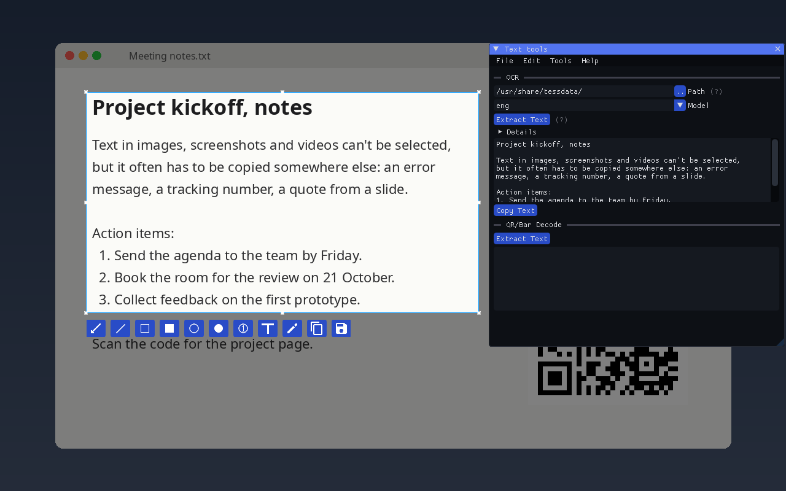
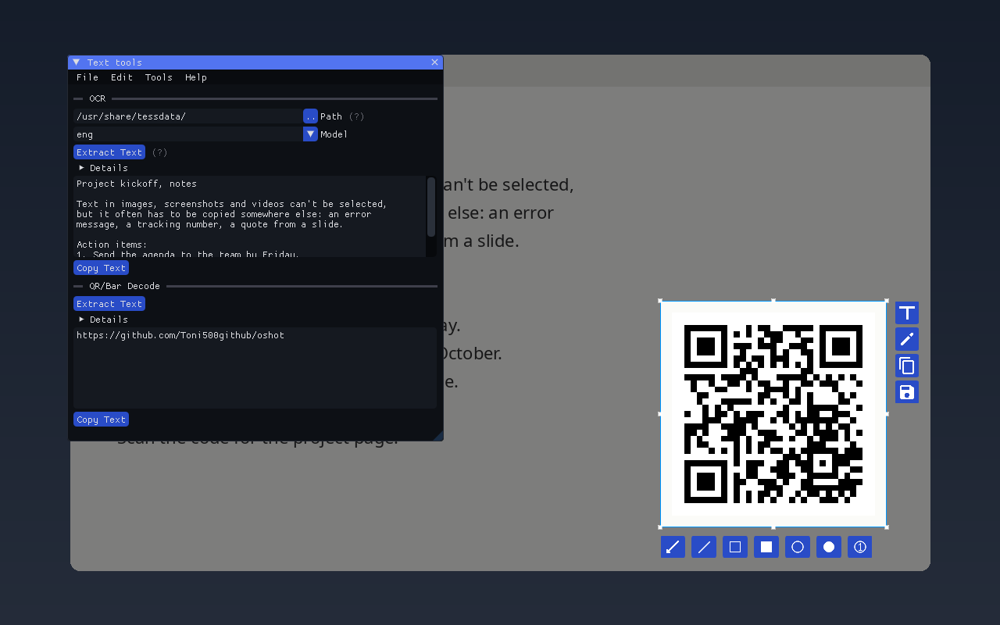
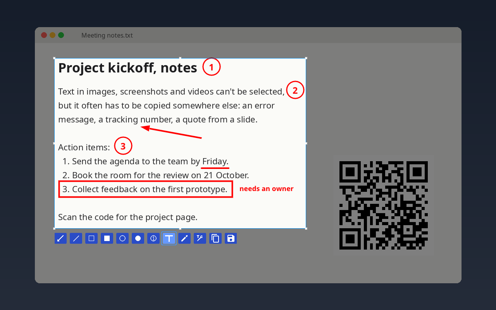

<p align="center">
  
</p>

<h1 align="center">oshot</h1>

<p align="center">
<b>The screenshot tool that can read.</b><br>
Capture, annotate, extract text and decode QR/barcodes in one overlay.<br>
Native and offline, on Linux, Windows and macOS.
</p>

<p align="center">
  <a href="https://github.com/Toni500github/oshot/releases/latest"></a>
  <a href="https://github.com/Toni500github/oshot/releases"></a>
  
  <a href="LICENSE"></a>
  
</p>

<p align="center">
  <a href="#installation">Install</a> ·
  <a href="#features">Features</a> ·
  <a href="#how-does-it-compare">Compare</a> ·
  <a href="#contributing">Contributing</a>
</p>

https://github.com/user-attachments/assets/8367490a-f7b0-4320-86e9-8ef8764a56b5

Press a hotkey, drag over anything on your screen, and take it with you: as text, as a decoded QR code or barcode, or as an
annotated image. Everything runs on your machine. No uploads, no account, no browser.

## Why oshot?

- **One tool instead of three.** A screenshot tool, an OCR app and the QR scanner on your phone, all working from the
  same selection.
- **Copy what you can't select.** Text in apps that block selection, VMs and remote desktops, videos, slides, error
  dialogs and images.
- **Private by default.** OCR (Tesseract) and barcode decoding (ZBar) run locally. oshot only goes online when you ask
  it to download an OCR language or install a plugin.
- **Native and light.** C++ and Dear ImGui, no Qt, no Electron, no Python runtime.
- **One overlay on every OS.** Linux (X11 and Wayland), Windows and macOS share the same overlay and config file. The
  BSDs build from source.
- **Extensible (optional).** The `-plugins` builds load plugins through a plain C ABI, so they can be written in any
  language that can export C functions.

| Extract text | Decode QR codes and barcodes | Annotate |
| :----------: | :--------------------------: | :------: |
|  |  |  |

<details>
<summary>Another demo</summary>

https://github.com/user-attachments/assets/800f50b3-95a6-47c4-b9bd-5a90c35941b2

</details>

## Features

**Capture**
- Region selection with resize handles, full-screen select (`Ctrl+A`) and capture delay
- Multi-monitor support on X11, Wayland (screenshot portal, Spectacle or grim), Windows and macOS
- Tray mode with a global hotkey on Windows and macOS (on Linux, bind `oshot --gui` in your desktop settings)
- Open existing images with `oshot -f <image>`
- Borderless overlay window, always on top

**Read**
- OCR via Tesseract, with multiple languages and a configurable segmentation mode
- In-app OCR model downloader
- QR code and barcode decoding via ZBar
- Edit the recognized text before copying it

**Annotate**
- Arrow, line, rectangle, circle, filled shapes, numbered counters, text and freehand pencil
- Color picker with zoom loupe, and undo
- Copy or save the result as an image (`Ctrl+C` / `Ctrl+S`)

**Customize**
- Dark theme by default, with colors, rounding and borders customizable in a TOML theme file
- Fonts, output filename format, behavior and rendering options, from the Preferences window or a TOML config file

**Extend** (only in the `-plugins` builds, see [Installation](#installation))
- Plain C ABI, so plugins can be written in any language that can export C functions, with UI through cimgui
- Install, update, enable and disable plugins from git repositories, in the text tools window or from the command line
  with `oshotpm`

## How does it compare?

|                       | oshot | [Flameshot](https://github.com/flameshot-org/flameshot) | [NormCap](https://github.com/dynobo/normcap) | [ShareX](https://github.com/ShareX/ShareX) |
| --------------------- | :---: | :-------: | :-----: | :----: |
| Annotation            | ✅ | ✅ | ❌ | ✅ |
| OCR                   | ✅ | ❌ ([#702](https://github.com/flameshot-org/flameshot/issues/702)) | ✅ | ✅ |
| QR / barcode decoding | ✅ | ❌ ([#511](https://github.com/flameshot-org/flameshot/issues/511)) | ✅ | ✅ |
| Linux                 | ✅ | ✅ | ✅ | ❌ ([#6625](https://github.com/ShareX/ShareX/issues/6625)) |
| Windows               | ✅ | ✅ | ✅ | ✅ |
| macOS                 | ✅¹ | ✅ | ✅ | ❌ |
| Plugins               | ✅² | ❌ | ❌ | ❌ |
| Pin captures to the screen | ❌ | ✅ | ❌ | ✅ |
| Upload and share      | ❌ | ✅ | ❌ | ✅ |
| Screen recording      | ❌ | ❌ | ❌ | ✅ |
| Distro packages / Flathub | AUR only | ✅ | ✅ | – |
| Built with            | C++, Dear ImGui | C++, Qt | Python, Qt | C#, WinForms |

<sub>¹ Apple Silicon Macs need macOS 26.4 or later for now, Intel Macs macOS 15. ² Only in the `-plugins` builds.</sub>

Some of these gaps are long-standing requests. Flameshot users have asked for
[OCR since 2020](https://github.com/flameshot-org/flameshot/issues/702) and for
[QR code scanning since 2019](https://github.com/flameshot-org/flameshot/issues/511), and
[Linux support for ShareX](https://github.com/ShareX/ShareX/issues/6625) has been requested since 2022. In oshot, OCR and
QR/barcode decoding are built in on every platform.

Flameshot and ShareX are mature tools with a lot that oshot doesn't do (yet), and they are far more widely packaged.
NormCap is focused on getting text into your clipboard. oshot is for when you want text and codes out of your screen,
and sometimes an annotated screenshot, from one tool on any OS.

Plugins can read the capture and the recognized text, replace the text output, draw their own UI and use the network,
so features such as uploading, translation or a different OCR engine could be built as plugins. None of these exist
yet: if you want to write one, [open an issue](https://github.com/Toni500github/oshot/issues) and I'll help.

<sub>Compared as of October 2026. Spotted something out of date? Please open an issue.</sub>

## Installation

Get the file for your system from the [latest release](https://github.com/Toni500github/oshot/releases/latest) page.
Each package also comes as a `-plugins` variant, which adds plugin support and the `oshotpm` plugin manager.
**If you don't use plugins, pick the file without `-plugins`.**

### Windows

Download the installer for your PC and run it:

| Package | PC |
| ------- | -- |
| `oshot-windows-x64-setup-<version>.exe` | Intel or AMD (most PCs) |
| `oshot-windows-arm64-setup-<version>.exe` | ARM, e.g. Snapdragon (Windows 11) |

- Installs for your user only by default (no admin prompt), with a Start Menu entry and an uninstaller.
- Optionally starts oshot in the system tray when you sign in.
- English OCR data is included. Downloaded models go to `%APPDATA%\oshot\models`.

Press **Alt+Shift+S** anywhere to capture while oshot is in the tray. You can change it in Preferences.

Prefer a portable copy? Download `oshot-windows-x64-<version>.zip` (or `-arm64-`), extract it anywhere and run `oshot.exe`.

On Windows on ARM, oshot draws with OpenGL, which ARM graphics drivers don't provide themselves. If oshot says it can't
create its window, install the [OpenCL and OpenGL Compatibility Pack](https://devblogs.microsoft.com/directx/announcing-the-opencl-and-opengl-compatibility-pack-for-windows-10-on-arm/)
from the Microsoft Store.

>[!NOTE]
>The installer is not code-signed yet, so SmartScreen may warn on first run: click **More info → Run anyway**.

---
### macOS

Download the `.dmg` that matches your Mac:

| Package | Mac | Requires |
| ------- | --- | -------- |
| `oshot-macos-arm64-<version>.dmg` | Apple Silicon (M1 and newer) | macOS 26.4 (Tahoe) or later |
| `oshot-macos-x86_64-<version>.dmg` | Intel | macOS 15 (Sequoia) or later |

Older macOS versions aren't supported yet: the bundled libraries come from Homebrew, which builds them for the macOS of our build machines.

1. Open the `.dmg` and drag **oshot** onto **Applications**.
2. The app isn't notarized yet, so macOS blocks the first launch. Run this once in Terminal:
   ```bash
   xattr -dr com.apple.quarantine /Applications/oshot.app
   ```
   Or open oshot once, then go to **System Settings → Privacy & Security** and click **Open Anyway**.
3. Grant **Screen Recording** permission when asked (System Settings → Privacy & Security → Screen Recording), then reopen oshot.

Press **Cmd+Shift+2** anywhere to capture while oshot is in the menu bar. You can change it in Preferences.

English OCR data is included. Downloaded models go to `~/.config/oshot/models`.
In the `-plugins` builds, the plugin manager is at `/Applications/oshot.app/Contents/MacOS/oshotpm`.

---
### Linux

| Package | Description |
| ------- | ----------- |
| `oshot-<arch>-<version>.AppImage` | Recommended. Self-contained, runs on most distributions |
| `oshot-debian-package-<arch>-<version>.deb` | Debian, Ubuntu and derivatives |
| `oshot-linux-x86_64-<version>.zip` | Generic binary, needs the runtime libraries installed (see [Dependencies](#dependencies)) |

`<arch>` is your CPU, as printed by `uname -m`: `x86_64` for Intel/AMD and `aarch64` for 64-bit ARM (the `.deb`s
use Debian's names, `amd64` and `arm64`). Other architectures, including 32-bit ARM, can [build from source](#build-from-source).

**AppImage**

```bash
chmod +x oshot-$(uname -m)-*.AppImage
./oshot-$(uname -m)-*.AppImage
```

The `oshot-<arch>-plugins-<version>.AppImage` also contains the `oshotpm` plugin manager. Plugins can be managed from
the text tools window, or on the command line by passing `oshotpm` as the first argument:

```bash
./oshot-$(uname -m)-plugins-*.AppImage oshotpm install https://github.com/user/repo
# or link it as oshotpm somewhere in your PATH
ln -s "$PWD"/oshot-$(uname -m)-plugins-*.AppImage ~/.local/bin/oshotpm
oshotpm list
```

**Debian / Ubuntu**

```bash
sudo apt install ./oshot-debian-package-*.deb
```

Use `apt` rather than `dpkg -i`, so the dependencies get installed too.

**Generic zip**

```bash
unzip oshot-linux-*.zip
sudo ./oshot/install.sh               # installs into /usr/local
sudo ./oshot/install.sh --uninstall   # removes it again
```

#### Arch Linux (AUR)

```bash
yay -S oshot-bin
```

#### Wayland

On GNOME and most other desktops, screenshots go through the desktop's screenshot portal (the first capture may ask for permission). KDE uses Spectacle. Where no screenshot portal is available (e.g. some Sway/Hyprland setups), install `grim`.
For copying to the clipboard, install `wl-clipboard`.

oshot doesn't need XWayland. Capturing, picking a monitor, copying and dialogs all talk to Wayland directly, and the
release packages (AppImage, `.deb` and zip) include GLFW 3.5 built for both X11 and Wayland, so the overlay is a native
Wayland window too. It works on compositors running without XWayland, such as Hyprland with XWayland disabled. If you
build oshot yourself, the overlay is native on Wayland when your distribution's GLFW is 3.4 or newer with Wayland
support (Arch's is); with an X11-only GLFW, such as Ubuntu's, it runs through XWayland.

#### Capture shortcut

On Linux, oshot doesn't register a global shortcut itself. Bind `oshot --gui` to a key in your desktop's keyboard settings (e.g. **Settings → Keyboard → Custom Shortcuts** on GNOME), or in your window manager's config, for example:

```ini
# Hyprland
bind = SUPER SHIFT, S, exec, oshot --gui
# Sway / i3
bindsym $mod+Shift+s exec oshot --gui
```

## Usage

```
oshot              # captures a screenshot and opens the overlay, then stays in the tray
oshot --gui        # only capture and open the overlay (for keyboard shortcuts)
oshot --tray       # start in the tray without capturing
oshot -f <path>    # open an image file instead of capturing

oshot --extract-text                                # print the text on the screen, no overlay
oshot -f <path> --extract-text --selection 400x80+10+20   # text of one region of an image
oshot --extract-barcode --instant-copy              # copy the QR codes/barcodes on the screen
oshot --instant-copy --selection "$(slop)"          # copy a region picked with slop as an image
```

### Keyboard shortcuts

| Shortcut | Action |
| -------------- | ----------------------- |
| `Ctrl+C/S` | Copy/Save selection as image |
| `Ctrl+A` | Select full image |
| `Ctrl+Z` | Undo |
| `Ctrl+G` | Toggle handles |
| `Ctrl+E` | Toggle text editing |
| `Esc` | Close |

## Build from Source

Requires a C++20 compiler.

### Dependencies

**All platforms:** `glfw3`, `tesseract`, `leptonica`, `zbar`, `OpenGL`, `libpng`

**Linux / BSD extras:** `libx11`, `libxrandr`, `gio-2.0`, `gtk+-3.0`, `dbus-1`, `libappindicator3` / `ayatana-appindicator3`, `wayland`, `wayland-protocols`

**macOS frameworks:** `Cocoa`, `Metal`, `QuartzCore`, `CoreGraphics`, `IOKit`

**Windows:** `d3d11`, `dxgi`, `shcore`, `ws2_32`

#### Ubuntu / Debian

```bash
sudo apt-get install -y \
  build-essential pkg-config cmake \
  libx11-dev libxrandr-dev libgl-dev \
  libglfw3-dev \
  libtesseract-dev libleptonica-dev \
  libzbar-dev \
  libgtk-3-dev libdbus-1-dev libayatana-appindicator3-dev \
  libwayland-dev libwayland-bin wayland-protocols
```

#### Arch Linux

```bash
sudo pacman -S --needed \
  base-devel cmake \
  libx11 libxrandr \
  glfw \
  tesseract leptonica \
  zbar \
  gtk3 libappindicator-gtk3 \
  wayland wayland-protocols
```

#### FreeBSD

```bash
pkg install git cmake pkgconf gmake \
  glfw tesseract zbar gtk3 libappindicator dbus \
  libX11 libXrandr mesa-libs wayland wayland-protocols
```

Other BSDs need the same libraries from their ports. FreeBSD is built in CI; the others aren't tested, so please report build errors.

#### macOS (Homebrew)

```bash
brew install cmake glfw tesseract leptonica zbar
```

#### Windows (MSYS2 UCRT64)

On Windows on ARM, use the CLANGARM64 environment instead, with the same packages named `mingw-w64-clang-aarch64-*`.

```bash
pacman -S --needed \
  mingw-w64-ucrt-x86_64-toolchain \
  mingw-w64-ucrt-x86_64-ninja \
  mingw-w64-ucrt-x86_64-cmake \
  mingw-w64-ucrt-x86_64-glfw \
  mingw-w64-ucrt-x86_64-libpng \
  mingw-w64-ucrt-x86_64-tesseract-ocr \
  mingw-w64-ucrt-x86_64-zbar
```

### Build

```bash
git clone https://github.com/Toni500github/oshot/
cd oshot
make                       # `gmake` on the BSDs
./build/release/oshot
sudo make install          # into /usr (/usr/local on the BSDs), or PREFIX=<dir>
sudo make uninstall
```

`make DISABLE_PLUGINS=1` builds without plugin support. Packagers can use `DESTDIR` with `make install`, or CMake directly; `-DOSHOT_INSTALL_LICENSEDIR=` changes or skips (empty) where the license goes.

Or with CMake + Ninja:

```bash
mkdir build && cd build
cmake .. -G Ninja -DCMAKE_BUILD_TYPE=Release
ninja
./oshot
```

## Troubleshooting

### Windows: flicker on launch / app fails to start

Download [MesaForWindows.7z](https://downloads.fdossena.com/geth.php?r=mesa64-latest), extract `opengl32.dll` beside `oshot.exe`, and relaunch.
This `opengl32.dll` is for x64 only; on Windows on ARM, install the OpenGL compatibility pack instead (see [Windows](#windows)).

### Linux: missing/mismatched runtime libraries

Use the AppImage build.

### Linux: clipboard issues

Run `oshot --tray` and launch captures from the tray icon instead.

### NixOS: Tesseract can't find language data

`TESSDATA_PREFIX` must be set explicitly. If tesseract is in `environment.systemPackages`:

```nix
environment.sessionVariables = {
    "TESSDATA_PREFIX" = "${pkgs.tesseract}/share/tessdata";
};
```

If it is in `users.users.<user>.packages`, use home-manager instead:

```nix
systemd.user.sessionVariables = {
    "TESSDATA_PREFIX" = "${pkgs.tesseract}/share/tessdata";
};
```
>[!Note]
>The home-manager solution requires systemd. If `echo $TESSDATA_PREFIX` returns a valid path but OCR still fails, check `ocr-path` in your config file.

### Still broken?

Open an [issue](https://github.com/Toni500github/oshot/issues) with your OS version, the exact error message, and steps to reproduce.

## How oshot is developed

oshot is a solo project. I've been building it since December 2025 in whatever time university and exams leave me.
A few people who use it daily have sent fixes, and the people in the r/unixporn Discord thread helped shape a lot of it,
but most days it's just me. For now, at least: see [Contributing](#contributing).

Since that time is short, I use AI coding tools (ChatGPT, Claude, DeepSeek) for a large part of the code and most of the
build and packaging setup. The help from that Discord thread is the reason less of it is AI-generated than it would
have been.

Nothing ships without me reading it and running it. I test every change on Linux (X11 and Wayland), Windows and macOS,
in VMs and on real hardware. I once nearly wrecked my school's monitor because a missing `glfwTerminate()` left it
stuck at a broken resolution, so I take the "real hardware" part seriously. If something is broken, that's on me, not
on a tool: [open an issue](https://github.com/Toni500github/oshot/issues) and I'll fix it.

## Contributing
Give oshot a shot, and if something bugs you, tell me. With one person behind it, every bug report and pull request
makes a real difference, for me and for everyone else using it.

No contribution is too small:
- **Found a bug or a crash?** [Open an issue](https://github.com/Toni500github/oshot/issues), even if you aren't sure
  it's a bug. A screenshot and your OS are often enough.
- **Spotted a typo or a misplaced dot?** Send a pull request. Yes, really, a one-character fix is welcome.
- **Missing a feature?** Open an issue first so we can talk about how it fits.
- **Using oshot daily?** Tell me what annoys you. That feedback is what shaped most of oshot so far.

AI-assisted pull requests are fine, as long as you understand the code and have tested it yourself.

If oshot saves you time, starring the repo helps other people find it.

## License

oshot is released under the [BSD 3-Clause License](LICENSE). Bundled third-party libraries keep their own licenses.
